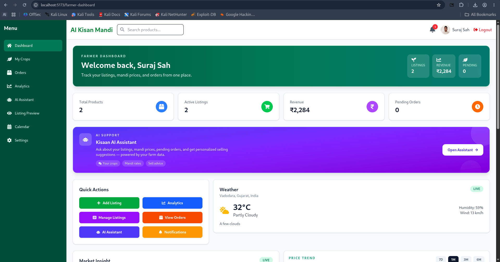
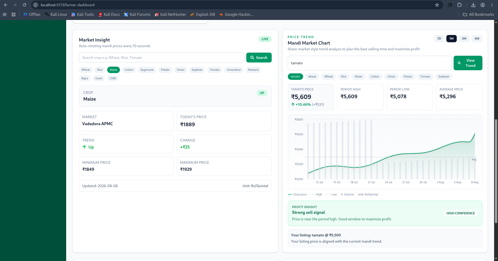
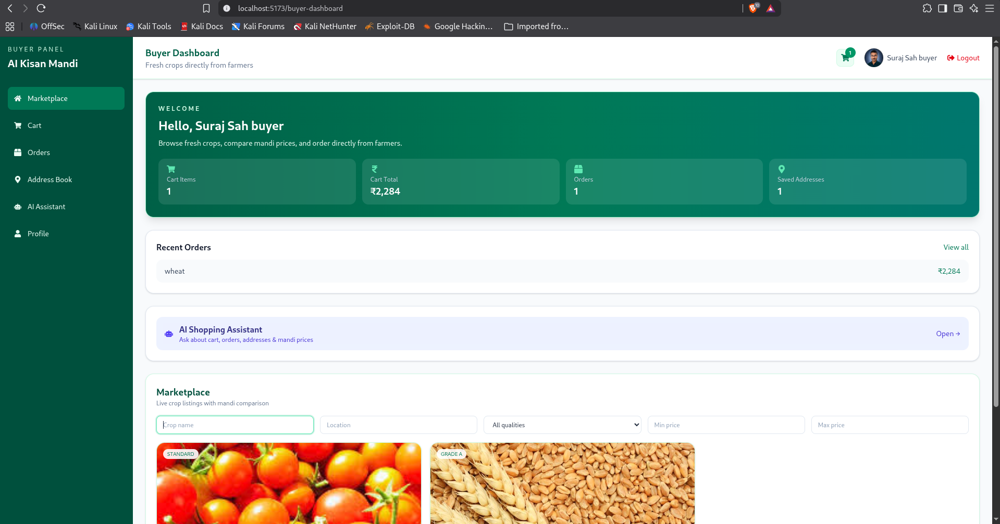
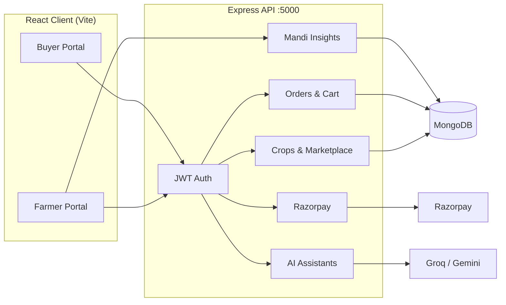

<div align="center">

# AI-Kisaan Mandi

**A smart MERN marketplace connecting Indian farmers and buyers — with mandi insights, AI assistants, and secure payments.**

[](https://github.com/SurajInCode/AI_Kisaan_Mandi/stargazers)
[](https://github.com/SurajInCode/AI_Kisaan_Mandi/network/members)
[](LICENSE)
[](CONTRIBUTING.md)

[Live Demo](#) · [Report Bug](https://github.com/SurajInCode/AI_Kisaan_Mandi/issues) · [Request Feature](https://github.com/SurajInCode/AI_Kisaan_Mandi/issues) · [Contributing](CONTRIBUTING.md)

**Repository:** [github.com/SurajInCode/AI_Kisaan_Mandi](https://github.com/SurajInCode/AI_Kisaan_Mandi)

</div>

---

## Screenshots

<p align="center">
  <strong>1. Farmer Dashboard</strong><br/>
  <em>Overview — stats, weather, AI assistant & quick actions</em>
</p>

<p align="center">
  
</p>

<br/>

<table align="center" width="100%">
  <tr>
    <td width="50%" align="center" valign="top">
      <strong>2. Farmer Analytics</strong><br/>
      <em>Live mandi prices & price trend charts</em><br/><br/>
      
    </td>
    <td width="50%" align="center" valign="top">
      <strong>3. Buyer Dashboard</strong><br/>
      <em>Marketplace, cart, orders & AI shopping assistant</em><br/><br/>
      
    </td>
  </tr>
</table>

---

## About

**AI-Kisaan Mandi** is a full-stack agriculture platform built with the **MERN stack** (MongoDB, Express, React, Node.js). Farmers can list crops, track orders, and get AI-powered selling advice. Buyers can browse the marketplace, manage addresses, pay via Razorpay (UPI/cards), and use an AI shopping assistant.

---

## Highlights

| For Farmers | For Buyers |
|-------------|------------|
| Dashboard with stats, weather, and top crops | Marketplace with filters and mandi price comparison |
| List crops with mandi price hints | Cart, checkout, and order history |
| Market analytics & price trends | Saved address book |
| AI selling assistant (Groq / Gemini) | AI shopping assistant |
| Order tracking & status updates | Razorpay (UPI / cards) + Cash on Delivery |
| Listing preview as buyers see it | Personalized buyer dashboard |

---

## Tech Stack

| Layer | Technologies |
|-------|--------------|
| **Frontend** | React 19, Vite 8, Tailwind CSS 4, React Router, Recharts, Axios |
| **Backend** | Node.js, Express 5, Mongoose, JWT, bcryptjs, Multer |
| **Database** | MongoDB |
| **Payments** | Razorpay (optional — COD always available) |
| **AI** | Groq & Google Gemini (optional — rule-based fallback) |

---

## Architecture



---

## Prerequisites

- **Node.js** 18 or newer
- **npm** 9 or newer
- **MongoDB** 6+ (local `mongod` or MongoDB Atlas)
- Git

Optional (for full feature set):

- [Groq API key](https://console.groq.com/keys) and/or [Gemini API key](https://aistudio.google.com/apikey)
- [Razorpay test keys](https://dashboard.razorpay.com/app/keys) for online payments

---

## Quick Start

### 1. Clone the repository

```bash
git clone https://github.com/SurajInCode/AI_Kisaan_Mandi.git
cd AI_Kisaan_Mandi
```

### 2. Install dependencies

```bash
cd server && npm install
cd ../client && npm install
```

### 3. Configure environment

```bash
cp server/.env.example server/.env
```

Edit `server/.env` and set at minimum:

| Variable | Required | Description |
|----------|----------|-------------|
| `MONGO_URI` | Yes | MongoDB connection string |
| `JWT_SECRET` | Yes | Long random string for signing tokens |
| `PORT` | No | API port (default `5000`) |
| `CLIENT_URL` | No | Frontend URL for production CORS setup |
| `GROQ_API_KEY` | No | Enables smarter farmer/buyer AI via Groq |
| `GEMINI_API_KEY` | No | Enables AI via Google Gemini |
| `AI_PROVIDER` | No | `auto`, `groq`, or `gemini` (default `auto`) |
| `RAZORPAY_KEY_ID` | No | Razorpay public key (test or live) |
| `RAZORPAY_KEY_SECRET` | No | Razorpay secret — **server only, never expose to client** |

Generate a strong JWT secret:

```bash
node -e "console.log(require('crypto').randomBytes(64).toString('hex'))"
```

### 4. Start MongoDB

```bash
# Linux (systemd)
sudo systemctl start mongod

# Or use MongoDB Atlas — set MONGO_URI in server/.env
```

### 5. Run the app

**Terminal 1 — API**

```bash
cd server
npm run dev
```

**Terminal 2 — Frontend**

```bash
cd client
npm run dev
```

| Service | URL |
|---------|-----|
| App | http://localhost:5173 |
| API | http://localhost:5000 |
| Health check | http://localhost:5000/api/health |

In development, Vite proxies `/api` and `/uploads` to the backend automatically.

---

## User Roles & Routes

### Farmer

| Route | Description |
|-------|-------------|
| `/farmer-dashboard` | Overview, weather, quick actions |
| `/farmer-crops` | Create and manage crop listings |
| `/farmer-analytics` | Market insights and price trends |
| `/farmer-assistant` | AI selling advisor |
| `/farmer-orders` | Incoming buyer orders |
| `/farmer-listing-preview` | Preview listings in marketplace style |
| `/farmer-calendar` | Crop calendar |
| `/profile` | Profile, mandi location, alert preferences |

### Buyer

| Route | Description |
|-------|-------------|
| `/buyer-dashboard` | Marketplace and recommendations |
| `/buyer-cart` | Shopping cart |
| `/buyer-checkout` | Address selection & payment |
| `/buyer-orders` | Order history |
| `/buyer-addresses` | Address book |
| `/buyer-assistant` | AI shopping helper |

---

## API Overview

All protected routes require `Authorization: Bearer <token>`.

| Method | Endpoint | Access | Description |
|--------|----------|--------|-------------|
| `POST` | `/api/auth/register` | Public | Register as farmer or buyer |
| `POST` | `/api/auth/login` | Public | Login |
| `GET` | `/api/auth/profile` | Auth | Get profile |
| `PUT` | `/api/auth/profile` | Auth | Update profile & photo |
| `GET` | `/api/crops` | Public | Browse marketplace (`?mandi=true` for mandi data) |
| `GET` | `/api/crops/my` | Farmer | Own listings |
| `POST` | `/api/crops` | Farmer | Create listing (image upload) |
| `GET` | `/api/farmer/dashboard` | Farmer | Dashboard stats |
| `GET` | `/api/farmer/orders` | Farmer | Orders for farmer's crops |
| `PATCH` | `/api/farmer/orders/:id/status` | Farmer | Update order status |
| `POST` | `/api/farmer/assistant/chat` | Farmer | AI assistant |
| `GET` | `/api/buyer/dashboard` | Buyer | Buyer dashboard data |
| `GET/POST` | `/api/buyer/cart` | Buyer | Cart operations |
| `POST` | `/api/buyer/orders` | Buyer | Place COD order |
| `GET` | `/api/buyer/payments/config` | Buyer | Payment methods |
| `POST` | `/api/buyer/payments/razorpay/create` | Buyer | Create Razorpay order |
| `POST` | `/api/buyer/payments/razorpay/verify` | Buyer | Verify payment & fulfill order |
| `GET` | `/api/market-insights` | Public | Mandi price insights |
| `GET` | `/api/market-insights/trend` | Public | Price trend data |

---

## Razorpay (Test Mode)

1. Create a [Razorpay](https://razorpay.com/) account and open **Test Mode**.
2. Copy **Key ID** and **Key Secret** into `server/.env`.
3. Restart the API server.
4. At checkout, choose **Pay Online** — UPI, cards, and wallets are enabled via Razorpay Checkout.

If Razorpay keys are not set, checkout falls back to **Cash on Delivery** only.

> Use Razorpay test cards and UPI IDs from their [test documentation](https://razorpay.com/docs/payments/payments/test-card-upi-details/). Never commit live keys.

---

## AI Assistants

The farmer and buyer assistants work out of the box with built-in rule-based replies. For richer answers:

1. Add `GROQ_API_KEY` and/or `GEMINI_API_KEY` to `server/.env`.
2. Set `AI_PROVIDER=auto` (tries Groq first, then Gemini) or pick a specific provider.
3. Restart the server and open `/farmer-assistant` or `/buyer-assistant`.

API keys stay on the server — they are never sent to the browser.

---

## Project Structure

```
AI_Kisaan_Mandi/
├── client/                 # React + Vite frontend
│   ├── src/
│   │   ├── components/     # UI components (Buyer, Chart, CropForm, …)
│   │   ├── hooks/          # Data fetching & state hooks
│   │   ├── pages/          # Route pages
│   │   └── utils/          # API client, Razorpay, helpers
│   └── vite.config.js      # Dev proxy to API
├── server/
│   ├── server.js           # Express entry point
│   ├── src/
│   │   ├── config/         # Environment validation
│   │   ├── controllers/    # Route handlers
│   │   ├── middleware/     # Auth & file upload
│   │   ├── models/         # Mongoose schemas
│   │   ├── routes/         # API routes
│   │   └── services/       # Business logic, AI, orders
│   ├── uploads/            # User-uploaded images (gitignored)
│   └── .env.example        # Environment template
├── docs/screenshots/       # README screenshots
├── CONTRIBUTING.md         # Contributor guide
├── LICENSE                 # MIT License
└── README.md
```

---

## Security

This section documents the security measures in place and recommendations before deploying to production.

### Verified protections

| Area | Implementation |
|------|----------------|
| **Secrets** | `server/.env` is gitignored; only `server/.env.example` (placeholders) is tracked. No API keys or passwords were found hardcoded in source. |
| **Authentication** | JWT (`Bearer` token, 7-day expiry) via `requireAuth` middleware |
| **Authorization** | Role-based guards: `requireFarmer`, `requireBuyer` on protected routes |
| **Passwords** | bcrypt hashing on registration; passwords excluded from API responses |
| **Ownership** | Farmers can only edit/delete their own crops; order status updates scoped to their listings |
| **Self-purchase** | Buyers cannot add their own crops to cart (checked server-side) |
| **Payments** | Razorpay HMAC-SHA256 signature verification before order fulfillment |
| **Pending payments** | Tied to buyer ID; prevents replay of another user's payment session |
| **File uploads** | Image-only filter, 5 MB limit, safe filename generation via Multer |
| **CORS** | Allowlist for localhost dev origins; unknown origins rejected |
| **AI keys** | Groq/Gemini keys read only from server environment |

### Before going live

1. **Rotate secrets** if any key was ever committed, shared in chat, or pasted in a public issue.
2. **Use strong `JWT_SECRET`** (64+ random bytes) and keep it consistent across server restarts.
3. **Use Razorpay live keys** only on HTTPS production domains.
4. **Update CORS** in `server/server.js` to include your production frontend URL (or wire `CLIENT_URL` from env).
5. **Serve the API over HTTPS** behind a reverse proxy (Nginx, Caddy, etc.).
6. **Use MongoDB Atlas** with IP allowlisting and a dedicated database user with least privilege.
7. **Back up** `server/uploads/` or move images to object storage (S3, Cloudinary) for production.

### Known limitations (planned improvements)

| Item | Risk | Suggestion |
|------|------|------------|
| No rate limiting | Brute-force login / AI abuse | Add `express-rate-limit` on `/api/auth` and assistant routes |
| JWT in `localStorage` | XSS could steal tokens | Consider `httpOnly` cookies + CSRF protection for production |
| No security headers | Missing CSP, HSTS, etc. | Add `helmet` middleware |
| Public `/uploads` | Anyone with URL can view images | Acceptable for crop photos; use signed URLs for sensitive files |
| No password strength rules | Weak passwords allowed | Enforce minimum length/complexity on register |

### Reporting vulnerabilities

If you discover a security issue, please **do not** open a public GitHub issue with exploit details. Contact the repository owner privately via [GitHub](https://github.com/SurajInCode).

---

## Production Build

```bash
# Frontend
cd client
npm run build
# Serve client/dist/ with any static host (Vercel, Netlify, Nginx)

# Backend
cd server
npm run dev   # or use PM2: pm2 start server.js --name kisaan-api
```

Set `VITE_API_BASE_URL=https://your-api-domain.com/api` when building the client for production.

---

## Troubleshooting

| Problem | Fix |
|---------|-----|
| `JWT_SECRET is missing` | Create `server/.env` from `.env.example` |
| `401` / session expired after restart | Log in again — server `JWT_SECRET` may have changed |
| Market trend `404` | Restart API server after pulling latest code |
| Checkout "Failed to load" | Ensure server is running and `/api/buyer/payments/config` responds |
| AI assistant generic replies | Add `GROQ_API_KEY` or `GEMINI_API_KEY` and restart server |
| Port 5000 already in use | Stop old Node processes: `fuser -k 5000/tcp` |

---

## Contributing

We love contributions from the community! Whether you're fixing a typo, improving docs, or building a new feature — you're welcome here.

### Quick steps

1. **Star** the repo to show support
2. **Fork** [AI_Kisaan_Mandi](https://github.com/SurajInCode/AI_Kisaan_Mandi/fork)
3. Create a branch: `git checkout -b feature/your-feature`
4. Commit with a clear message: `feat: add Hindi assistant replies`
5. Push and open a [Pull Request](https://github.com/SurajInCode/AI_Kisaan_Mandi/compare)

Read the full guide in **[CONTRIBUTING.md](CONTRIBUTING.md)** — setup, branch naming, PR checklist, and good first issue ideas.

### Contributors

Thanks to everyone who helps improve AI-Kisaan Mandi!

<a href="https://github.com/SurajInCode/AI_Kisaan_Mandi/graphs/contributors">
  
</a>

---

## License

This project is licensed under the **MIT License** — see the [LICENSE](LICENSE) file for details.

---

## Acknowledgements

- Indian mandi price data concepts for farmer decision support
- [Razorpay](https://razorpay.com/) for payment infrastructure
- [Groq](https://groq.com/) and [Google Gemini](https://ai.google.dev/) for optional AI features

---

<div align="center">

**[AI-Kisaan Mandi](https://github.com/SurajInCode/AI_Kisaan_Mandi)** — Empowering farmers, connecting buyers.

Made with care by [SurajInCode](https://github.com/SurajInCode)

If this project helped you, consider giving it a star on GitHub!

</div>
